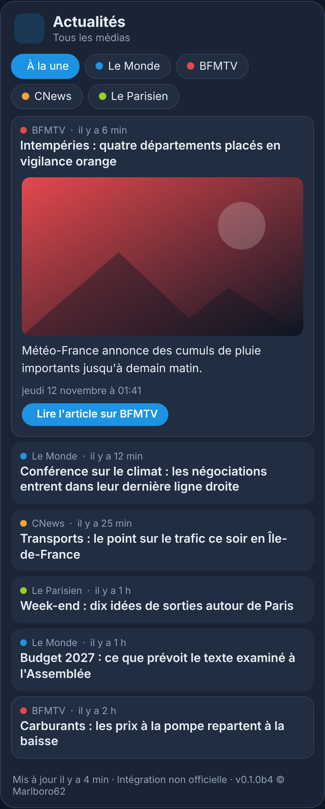

# Actualités France pour Home Assistant

<p>
  ☕ <strong>Si cette carte vous est utile, vous pouvez soutenir le projet :</strong>
</p>

<div style="white-space: nowrap; line-height: 0;">
  <a
    href="https://www.buymeacoffee.com/Marlboro62"
    target="_blank"
    rel="noopener noreferrer"
    style="display: inline-block; text-decoration: none; vertical-align: middle;"
  ></a>&nbsp;&nbsp;<a
    href="https://ko-fi.com/M4M2QL45X"
    target="_blank"
    rel="noopener noreferrer"
    style="display: inline-block; text-decoration: none; vertical-align: middle;"
  ></a>
</div>


Intégration et carte **non officielles** pour suivre l'actualité des **médias français** depuis votre tableau de bord : **Le Monde**, **BFMTV**, **CNews**, **Le Parisien** et d'autres au choix. La carte affiche les **titres** ; un clic sur un titre **déroule l'image et le résumé** publiés par le média, avec un bouton vers l'article complet sur son site.

> Ce projet n'est affilié à aucun des médias cités. Il lit leurs **flux RSS publics** (titre, résumé, image, date), comme un lecteur de flux. Les articles et leur contenu appartiennent à chaque média : l'article complet se lit sur son site.

🎮 **[Essayer la démo en ligne](https://marlboro62.github.io/news-fr-card/docs/demo.html)** : la vraie carte avec des titres et des résumés fictifs, sans installer Home Assistant (bleu nuit ou clair, et **simulation d'une Alerte Enlèvement fictive** pour voir la fenêtre d'alerte).

<p align="center">
  
</p>

<p align="center"><em>Capture de la démo : titres et résumés fictifs.</em></p>

## Fonctionnalités

- **Onglets par média** et onglet **À la une**, qui mélange tous les médias du plus récent au plus ancien.
- **Clic sur un titre** : l'image, le résumé, la date et le bouton **Lire l'article sur …** se déroulent ; un second clic replie l'article.
- **Voir plus** en bas de la liste pour afficher les titres suivants.
- **Un capteur par média** (nombre d'articles lus, articles en attributs), sans historique dans la base de Home Assistant.
- **Flux en panne** : la carte le signale et garde les derniers titres lus ; les autres médias continuent de s'afficher.
- **Alerte Enlèvement** : fenêtre d'alerte sur toutes les vues de Home Assistant quand une alerte est en cours (voir plus bas).
- **Thème** bleu nuit (par défaut), clair automatique ou thème de Home Assistant.

## 🚨 Alerte Enlèvement

L'intégration surveille **en permanence** le [dispositif Alerte Enlèvement](https://fr.wikipedia.org/wiki/Dispositif_Alerte-Enl%C3%A8vement) : quand il est déclenché, les médias signataires de la convention doivent diffuser l'alerte au moins trois heures.

- Les titres de **franceinfo, Le Monde, BFMTV, 20 Minutes et Le Parisien** sont lus pour la détection, même s'ils ne sont pas cochés (sans onglet ni capteur supplémentaire).
- L'alerte est considérée **en cours** quand **au moins deux médias différents** titrent « Alerte enlèvement » dans les 6 dernières heures, et **terminée** dès qu'un article annonce sa levée ou que l'enfant est retrouvé (sinon 6 heures après le dernier article).
- Le capteur `binary_sensor.actualites_france_alerte_enlevement` passe à **on**, avec en attributs le titre, le résumé, la photo, le lien et les médias : utilisable dans vos automatisations (notification, annonce vocale…).
- Une **fenêtre d'alerte** s'ouvre par-dessus Home Assistant, **sur toutes les vues et tous les appareils**, même sans la carte affichée. Elle n'est **pas désactivable** : **J'ai pris connaissance** la ferme pour cette alerte, sur cet appareil.
- La carte affiche aussi un **bandeau rouge** tant que l'alerte est en cours.

> Si vous avez une information sur une alerte en cours, **appelez le 197** et n'intervenez pas vous-même. La source officielle reste le ministère de la Justice et les médias : cette détection automatique peut avoir du retard sur l'alerte réelle.

## Médias proposés

| Média | Flux lu |
| --- | --- |
| Le Monde | À la une |
| BFMTV | Info en continu |
| CNews | Plan du site Google Actualités : titres et images, **sans résumé** (CNews ne publie pas de flux RSS classique) |
| Le Parisien | À la une : titres seulement, **sans résumé, image ni heure** (le flux n'en contient pas ; le jour est tiré de l'adresse de l'article) |
| franceinfo | Les titres |
| Le Figaro | Actualités |
| 20 Minutes | À la une |
| Libération | À la une |
| Ouest-France | À la une |
| France 24 | Édition française |

Le Monde, BFMTV, CNews et Le Parisien sont cochés par défaut. Vous pouvez aussi **ajouter n'importe quel flux RSS ou Atom** (un média régional, un blog) dans les options : une ligne par flux, de la forme `Nom | https://adresse-du-flux`.

> Un média peut changer l'adresse de son flux. Si un onglet affiche « Flux indisponible », [ouvrez une issue](https://github.com/Marlboro62/news-fr-card/issues) : en attendant, ajoutez la nouvelle adresse dans **Autres flux RSS**.

## Installation

### Avec HACS (dépôt personnalisé)

1. Ouvrez **Paramètres › Marketplace** (ou **HACS** avant la 2026.11), menu **⋮ › Dépôts personnalisés**.
2. Ajoutez `https://github.com/Marlboro62/news-fr-card`, catégorie **Intégration**.
3. Installez **Actualités France**, puis **redémarrez Home Assistant**.
4. **Paramètres › Appareils et services › Ajouter une intégration › Actualités France** : cochez les médias à suivre.
5. **Rechargez la page** du navigateur (Ctrl+F5) : la carte **Actualités France** apparaît dans la liste des cartes. Aucune ressource à ajouter, l'intégration charge la carte elle-même.

### Manuellement

Copiez le dossier `custom_components/news_fr` dans le dossier `config/custom_components` de Home Assistant, redémarrez, puis suivez les étapes 4 et 5.

## Options de l'intégration

**Paramètres › Appareils et services › Actualités France › Configurer**

| Option | Rôle | Défaut |
| --- | --- | --- |
| Médias suivis | Un capteur par média coché ; un média décoché voit son capteur supprimé | Le Monde, BFMTV, CNews, Le Parisien |
| Autres flux RSS | Une ligne par flux : `Nom \| https://adresse-du-flux` | (vide) |
| Articles par média | Nombre d'articles gardés pour chaque média (5 à 50) | 20 |
| Lecture des flux toutes les | En minutes, 10 au minimum pour ne pas surcharger les sites | 15 |

Les flux sont relus en parallèle, avec les en-têtes `ETag` / `Last-Modified` : un flux qui n'a pas changé n'est pas retéléchargé.

## Carte

```yaml
type: custom:news-fr-card
```

| Option | Rôle | Défaut |
| --- | --- | --- |
| `title` | Titre de la carte | `Actualités` |
| `entities` | Médias affichés, dans cet ordre (vide : tous les médias de l'intégration) | tous |
| `max_items` | Nombre de titres affichés ; **Voir plus** affiche la suite | `10` |
| `show_all` | Onglet **À la une** (tous les médias mélangés) | `true` |
| `show_images` | Image de l'article quand on le déroule | `true` |
| `theme` | `v2` (bleu nuit), `auto` (clair si Home Assistant est en mode clair), `ha` (thème de Home Assistant) | `v2` |

Toutes les options sont aussi disponibles dans l'**éditeur visuel**. Le bas de la carte indique sa version, pratique pour les signalements.

Exemple : une carte pour Le Monde et franceinfo seulement.

```yaml
type: custom:news-fr-card
title: Infos du matin
entities:
  - sensor.actualites_france_le_monde
  - sensor.actualites_france_franceinfo
max_items: 8
```

## Vie privée

- Home Assistant télécharge les flux RSS publics des médias choisis : aucun compte, aucune donnée personnelle envoyée.
- Les images des articles sont chargées par votre navigateur depuis le site du média, quand vous déroulez un article.
- Le bouton **Lire l'article** ouvre le site du média dans un nouvel onglet.

## Support

Uniquement via les [issues GitHub](https://github.com/Marlboro62/news-fr-card/issues) : une issue par demande ou par problème.

## Historique des versions

### 0.1.2b2

- 🐛 **Flux mal formés** (« & » non échappé, entités HTML, caractères de contrôle) : réparés avant lecture au lieu d'afficher « flux illisible » ; message clair quand un site renvoie une page web au lieu du flux.

### 0.1.2b1

- 🐛 **Titres en double** : quand un média publie deux fois le même titre (par exemple France 24 : la version « 🔴 » en direct sans résumé, puis l'article), une seule entrée est gardée, celle qui a un résumé et une image.

### 0.1.1

- 🐛 **Le Parisien** : son flux ne donne ni date, ni résumé, ni image. Le jour de publication est tiré de l'adresse de l'article (« aujourd'hui », « hier ») ; les articles qui apparaissent ensuite prennent l'heure de leur apparition.
- 🐛 **À la une** : les articles sans heure passent après les articles datés au lieu d'envahir le haut de la liste.

### 0.1.0

Première version stable (regroupe les bêtas 0.1.0b1 à b4) :

- 📰 **10 médias proposés** (Le Monde, BFMTV, CNews, Le Parisien cochés par défaut, puis franceinfo, Le Figaro, 20 Minutes, Libération, Ouest-France, France 24) et vos propres flux RSS ou Atom.
- 🗂️ **Carte** chargée automatiquement : onglets par média, **À la une**, articles déroulants (image, résumé, lien vers l'article), **Voir plus**.
- 🚨 **Alerte Enlèvement** : détection dans les titres des médias signataires, capteur `binary_sensor` et fenêtre d'alerte sur toutes les vues de Home Assistant, non désactivable ; bandeau rouge dans la carte.
- 🛠️ Flux lus en entier, dates reconnues dans plusieurs formats, flux en panne signalé (Le Point retiré : son site refuse la lecture du flux).

## Licence

[MIT](LICENSE) © 2026 Marlboro62. Les titres, résumés et images affichés appartiennent à leurs médias respectifs.
